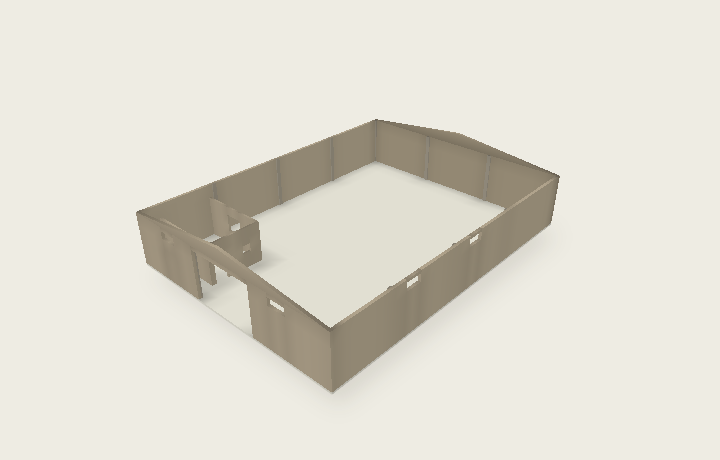

# Hangar — Visite architecturale

Une visite 3D publique et un plan architectural en français, pour mobile et ordinateur. Aucune inscription, aucun service externe requis pour consulter la maquette.

**[Ouvrir la visite publique](https://edificio-24x18-modelo-3d.daniotero.chatgpt.site/)**



## Explorer

- Sept vues : ensemble, arrière, intérieur, volumes, plan, façade et latérale.
- Rotation libre, rotation automatique à 360°, zoom et déplacement tactile.
- Éléments du bâtiment activables séparément, coupe horizontale et cotes.
- Inspection des éléments avec leurs photographies de référence.
- Mesure entre deux points, sur la maquette ou le plan.
- Partage du lien public ; exports HTML autonome, GLB, SVG et PNG.
- Installation à l’écran d’accueil et consultation hors connexion après la première visite.

Sur ordinateur : glisser pour tourner, molette pour zoomer, bouton droit pour déplacer. Sur mobile : un doigt pour tourner, deux doigts pour zoomer et déplacer. En plan : glisser pour déplacer. Le bouton de réglages en haut ouvre les options sur mobile.

## Géométrie et fidélité

Dimensions générales fournies : **24 × 18 m**, murs de **4 m**, point haut de **5 m**. La façade est supposée mesurer 18 m et les dimensions sont considérées comme extérieures.

Le modèle reprend les murs, pignons, ouvertures, raidisseurs et les deux locaux en retrait observables sur les sept photographies. Les dimensions secondaires et les épaisseurs restent estimées : elles peuvent être corrigées dans les réglages. Aucun mobilier, équipement sanitaire ou couverture non documenté n’a été ajouté. La maquette ne remplace pas un relevé sur place.

Le plan et les exports utilisent exactement les mêmes maillages métriques que le viseur 3D. La refonte graphique R04 conserve les 47 maillages de la reconstruction R03.

## Développement

```sh
npm ci
npm run build
```

Ouvrir `dist/index.html` dans un navigateur. Le dossier `docs/` contient également la version prête à publier sur GitHub Pages, sans compilation. La page embarque le moteur 3D, la géométrie et les photographies pour fonctionner sans CDN.

- `src/model.js` : géométrie exprimée en mètres et paramètres.
- `src/app.js` : visite, mesures et interactions.
- `src/plan.js` : plan vectoriel et image.
- `src/canvas-renderer.js` : rendu de compatibilité quand WebGL est indisponible.
- `public/` : miniatures, manifeste et service worker.
- `scripts/render-previews.mjs` : génération facultative des miniatures à partir de la géométrie réelle ; nécessite `@napi-rs/canvas`.

## GitHub Pages

Le site est prêt dans **`docs/`**. Dans **Settings → Pages → Build and deployment**, choisir **Deploy from a branch**, puis **main** et **/docs**, et enregistrer. GitHub fournit alors l’adresse publique du site. Aucune clé ni variable secrète n’est nécessaire.

Après une modification du code : exécuter `npm run build`, recopier le contenu de `dist/` dans `docs/`, puis pousser le commit. La visite autonome `Batiment_24x18_Visite_3D.html` peut aussi être envoyée directement.

## Bibliothèques

Three.js et esbuild sont distribués selon leurs licences respectives. La notice MIT de Three.js est conservée dans le fichier compilé.
